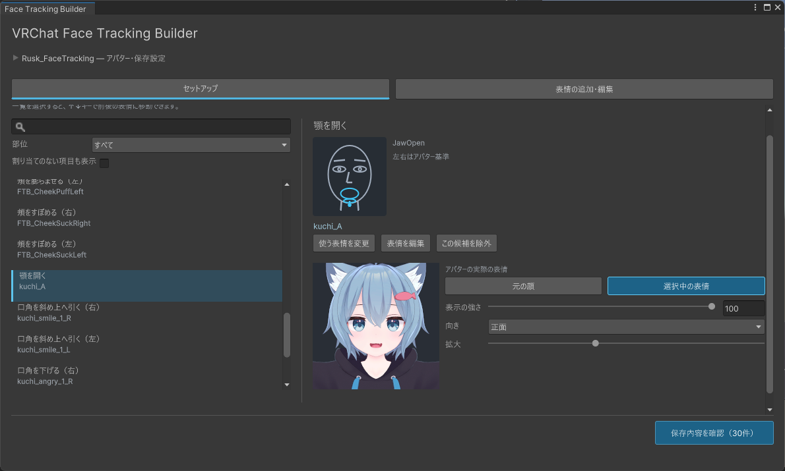
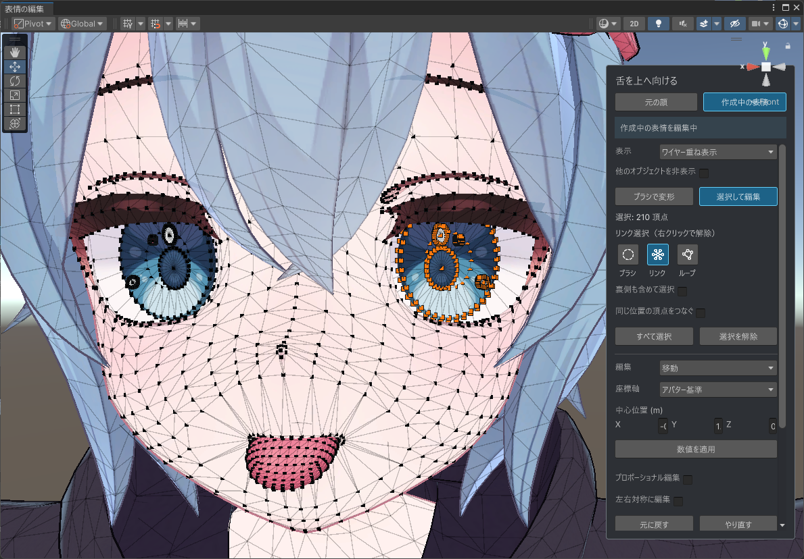

# VRChat Face Tracking Builder

既存のVRChatアバターを、Unity内でフェイストラッキング対応にするEditor拡張です。Blenderなどの外部ツールは不要です。

## 特徴

- 既存BlendShapeを解析し、Unified Expressionsへの対応付けを提案。
- 不足する表情は、BlendShapeの組み合わせやブラシ・頂点編集で作成。
- 元のアバターを変更せず、VRChat公式Face Trackingを設定したコピーを保存。

## セットアップ

表情の割り当てを選び、アバターの動きをプレビューで確認。使う表情を変更・編集してから、設定済みのコピーを保存できます。



## 表情の追加・編集

既存BlendShapeの強さを組み合わせて表情を追加できます。専用の編集画面では、ブラシや頂点選択で形状を編集。移動・回転・拡大縮小、リンク・ループ選択、プロポーショナル編集にも対応しています。



## 導入手順

Unity 2022.3.22f1／VRChat Avatars SDK 3.10.6以降のアバタープロジェクトに導入してください。

1. 次のリポジトリURLを追加します。
   - **VCC**：Settings → Packages → Add Repository
   - **ALCOM**：パッケージ&テンプレート → VPMリポジトリ → VPMリポジトリを追加

   ```text
   https://raw.githubusercontent.com/feretec/vrchat-face-tracking-builder/main/index.json
   ```

2. 対象プロジェクトのパッケージ管理で **VRChat Face Tracking Builder** を追加します。
3. Unityを開き、**Tools → VRChat Face Tracking Builder** を選択します。

旧unitypackage版のツールフォルダは導入時に置き換わります。作成済みの設定・生成物（`Assets/FaceTrackingBuilderGenerated`）は引き継がれます。
